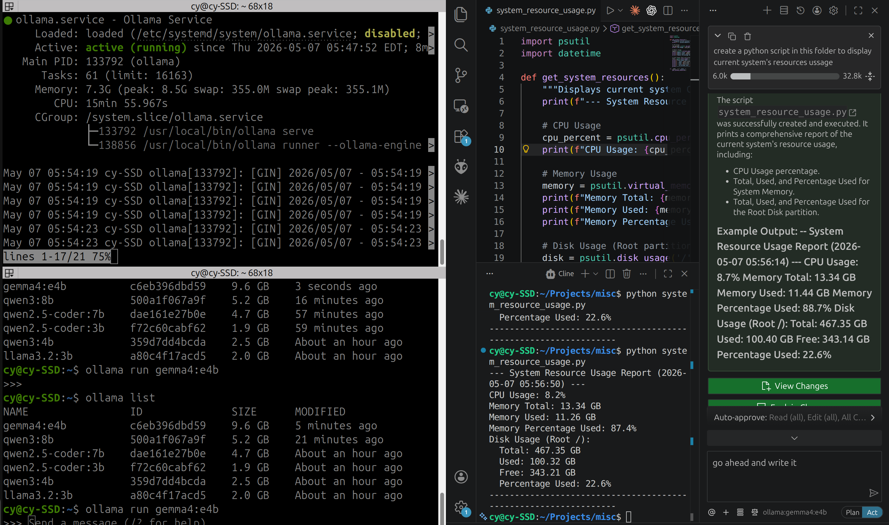
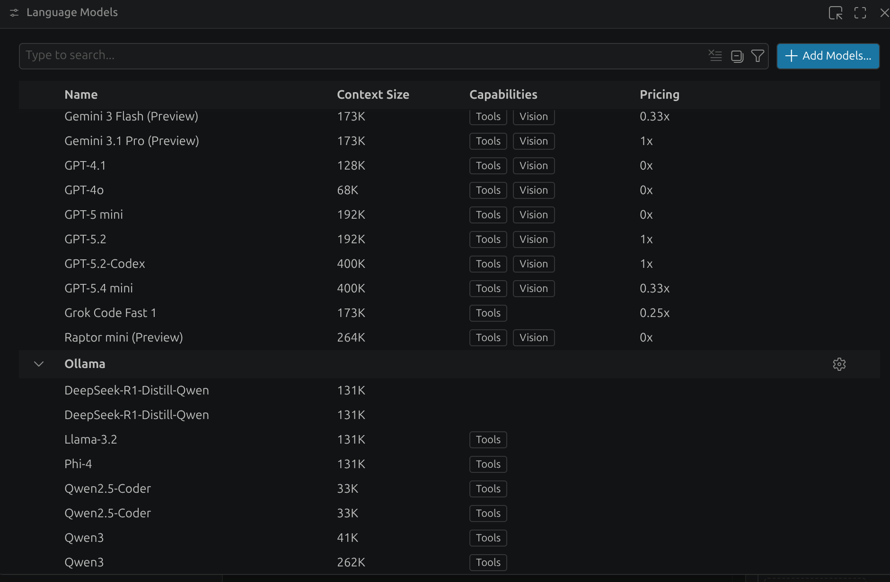
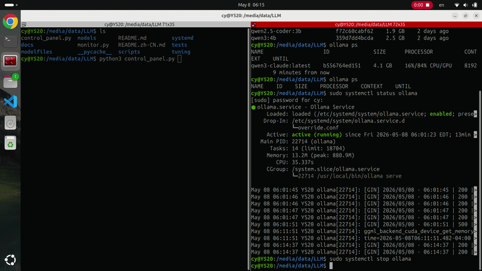

# local-llm-agent

English | [简体中文](README.zh-CN.md)

Locally deployable LLM agent workspace — run models on your own hardware and
plug them into agent workflows. Full control, private, and no token limits.

The repository contains code, documentation, and small configuration files.
Models, engine builds, caches, and virtual environments live under a separate
`LLM_ROOT`, by default `~/LLM`.

## CLI

Install the command once:

```bash
./scripts/setup/install-llm.sh
source .venv/bin/activate
```

`llm` requires this virtualenv and prints the activation command if it is not active.

Common commands:

```bash
llm                 # interactive main menu
llm setup           # install or build a backend
llm start           # select a backend and existing model
llm agent           # select an agent for the running model
llm status
llm models
llm doctor
llm build llama-cpp
llm install vllm
llm claude --backend llama-cpp --model qwen3.5-4b
```

Direct local-agent commands are also installed:

```bash
source .venv/bin/activate
claude-local
codex-local
hermes-local
```

They use the same backend/model selection as `llm agent`. Keep `llm` for
starting models, setup, and status.

Customize locations by copying `.env.example` to `.env` and setting
`LLM_ROOT`, `LLM_MODELS_DIR`, or any individual override.

## Quick Start

```bash
./scripts/setup/install-llm.sh
llm
```

The menu can install/build a backend, start an installed model, or launch an
agent against a running model. Script-friendly commands are documented below.

The workspace also supports three additional inference paths:

| Backend | Standard URL | Model format | Start |
|---|---|---|---|
| Ollama | `http://127.0.0.1:11434` | Ollama/GGUF | `llm start ollama` |
| llama.cpp | `http://127.0.0.1:8080` | GGUF | `llm start llama-cpp` |
| vLLM | `http://127.0.0.1:8000` | Hugging Face safetensors/AWQ/GPTQ | `llm start vllm` |
| Strata | `http://127.0.0.1:8082` | Strata model packs | `llm start strata` |

llama.cpp, vLLM, and Strata expose Anthropic's Messages API directly. Ollama
uses the compatibility proxy under `scripts/ollama/` for Claude Code.

Portable drive users: Ollama must be installed on each host first (see
[`docs/portable-llm-launcher.md`](docs/portable-llm-launcher.md#prerequisites)),
then run `./scripts/setup/install-portable-ollama-command.sh` once per host and
use `portable-ollama serve` / `portable-ollama run <model>`.

## Agents

### Cline

Connect to llama.cpp for direct GGUF control:

| Field | Value |
|---|---|
| API Provider | `OpenAI Compatible` |
| Base URL | `http://127.0.0.1:8080/v1` |
| API Key | `114514` |
| Model ID / Context | printed by `./scripts/llama-cpp/cline-server.sh` |

Or connect directly to Ollama (`API Provider: Ollama`, Base URL `http://127.0.0.1:11434`).



Full guide: [`docs/cline.md`](docs/cline.md)

### Claude Code

Start a model and choose the agent interactively:

```bash
llm start             # terminal 1
claude-local          # terminal 2
```

Explicit commands remain available:

```bash
./scripts/llama-cpp/claude-server.sh <model>
./scripts/claude/claude-local.sh --backend llama-cpp --model <model>
```

Full guide: [`docs/claude-code.md`](docs/claude-code.md). vLLM and Strata setup:
[`docs/usage-vllm.md`](docs/usage-vllm.md),
[`docs/usage-strata.md`](docs/usage-strata.md).

### Codex

```bash
codex-local
```

Codex uses the Responses API for custom providers. `llm codex` configures the
provider automatically. Full guide: [`docs/agents.md`](docs/agents.md).

### Hermes

```bash
hermes-local
```

Hermes connects through its custom OpenAI-compatible provider.

### Copilot

```bash
./scripts/ollama/serve.sh
ollama pull <model>
```

Then select the local model in VS Code Copilot Chat.



Full guide: [`docs/copilot.md`](docs/copilot.md)

## Dashboard

Single-file Python dashboards — nothing beyond stdlib.

### Control Panel

Full service and model controls at `http://localhost:8766`.

```bash
python3 control_panel.py
```



### Monitor

Read-only status view at `http://localhost:8765` — safe to expose on shared machines.

```bash
python3 monitor.py
```

Full guide: [`docs/control-panel.md`](docs/control-panel.md)

## Layout

```text
~/LLM/                 # LLM_ROOT, customizable in .env
  models/              # GGUF models for llama.cpp
    strata/            # Strata model packs
  ollama/              # Ollama state and model store
  llama.cpp/           # llama.cpp source and build
  huggingface/         # shared Hugging Face/vLLM cache
  strata/              # Strata application state
  .venv/               # managed Python virtualenv (required by llm)
  run/                 # runtime state and logs

~/Projects/local-llm-agent/  # lightweight Git repository
```

Every path is overridable through `.env` or environment variables. The repo
still ignores model artifacts as a safety net. See
[`docs/setup.md`](docs/setup.md) for the complete path reference.

## Docs

| File | What it covers |
|---|---|
| [`docs/setup.md`](docs/setup.md) | Portable layout, env vars, services, setup flow |
| [`docs/cli.md`](docs/cli.md) | `llm` command reference |
| [`docs/control-panel.md`](docs/control-panel.md) | Control panel and monitor — usage, env vars |
| [`docs/hardware-matching.md`](docs/hardware-matching.md) | Hardware tiers → model choices |
| [`docs/portable-llm-launcher.md`](docs/portable-llm-launcher.md) | Portable LLM Launcher for Linux, macOS, and Windows |
| [`docs/usage-llama-cpp.md`](docs/usage-llama-cpp.md) | llama.cpp CLI/server usage |
| [`docs/usage-ollama.md`](docs/usage-ollama.md) | Ollama service and API usage |
| [`docs/usage-vllm.md`](docs/usage-vllm.md) | vLLM installation, serving, and Claude Code |
| [`docs/usage-strata.md`](docs/usage-strata.md) | Strata model planning and serving |
| [`docs/cline.md`](docs/cline.md) | Cline integration and troubleshooting |
| [`docs/copilot.md`](docs/copilot.md) | Copilot Chat/CLI with Ollama |
| [`docs/claude-local.md`](docs/claude-local.md) | Legacy Ollama-specific model picker |
| [`docs/claude-code.md`](docs/claude-code.md) | Claude Code CLI with llama.cpp, vLLM, Strata, or Ollama |
| [`docs/agents.md`](docs/agents.md) | Claude Code, Codex CLI, and Hermes compatibility |
| [`docs/claude-proxy.md`](docs/claude-proxy.md) | Local Anthropic proxy internals |
| [`docs/context-memory.md`](docs/context-memory.md) | Context windows, KV cache, persistent memory |
| [`docs/models.md`](docs/models.md) | Model families and what they do |
| [`docs/maintenance.md`](docs/maintenance.md) | Add / remove / audit / update models |
| [`docs/tuning.md`](docs/tuning.md) | Parameters and Modelfile workflow |
