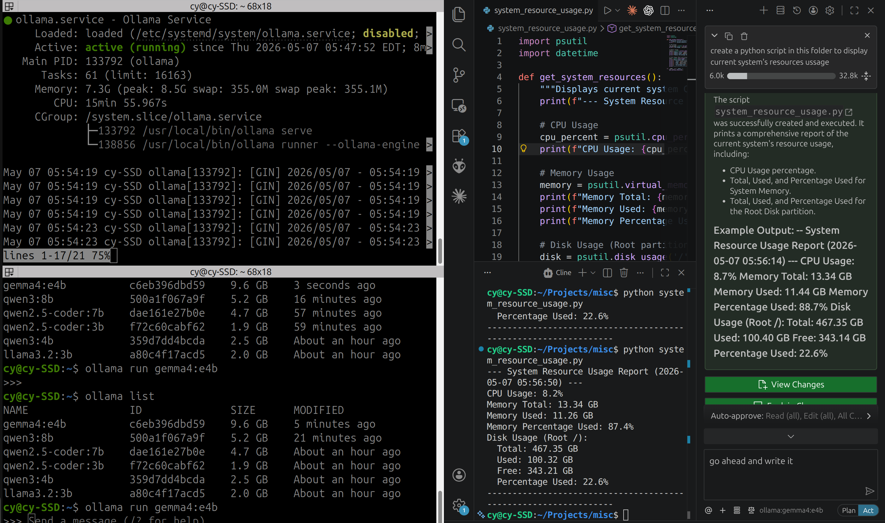
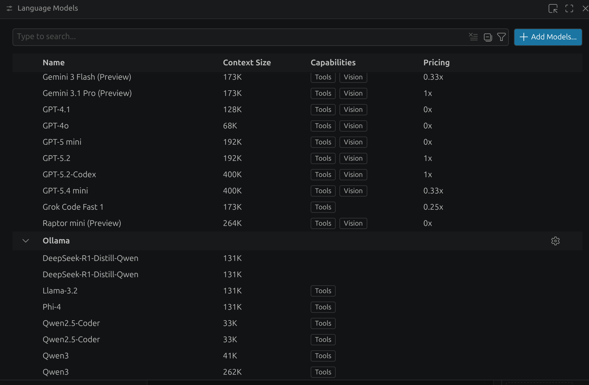
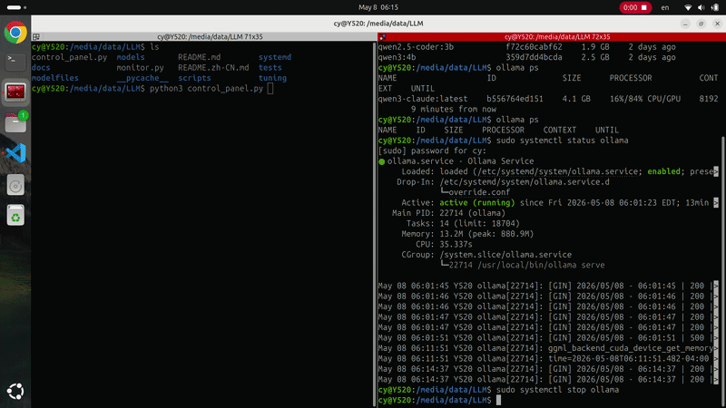

# local-llm-agent

[English](README.md) | 简体中文

本地化部署的 LLM agent 工作区——在自有硬件上运行模型，对接 agent 工作流。数据完全自主可控，无 token 限制，隐私安全。

仓库只保存代码、文档和小型配置。模型、引擎构建、缓存和虚拟环境统一放在
`LLM_ROOT` 下，默认是 `~/LLM`。

## CLI

```bash
./scripts/setup/install-llm.sh
llm
llm setup
llm start
llm agent
llm doctor
llm build llama-cpp
llm install vllm
llm claude --backend llama-cpp --model qwen3.5-4b
```

复制 `.env.example` 为 `.env` 即可自定义 `LLM_ROOT` 或其他目录。

## 快速开始

```bash
./scripts/setup/install-llm.sh
llm
```

交互菜单可以安装/构建后端、启动已有模型，或为正在运行的模型选择 Agent。

本仓库还支持以下推理后端：

| 后端 | 默认地址 | 模型格式 | 启动命令 |
|---|---|---|---|
| Ollama | `http://127.0.0.1:11434` | Ollama/GGUF | `llm start ollama` |
| llama.cpp | `http://127.0.0.1:8080` | GGUF | `llm start llama-cpp` |
| vLLM | `http://127.0.0.1:8000` | Hugging Face/AWQ/GPTQ | `llm start vllm` |
| Strata | `http://127.0.0.1:8082` | Strata 模型包 | `llm start strata` |

新版 llama.cpp、vLLM 和 Strata 原生支持 Anthropic Messages API。只有 Ollama
需要 `scripts/ollama/` 中的兼容代理。

便携硬盘用户：每台宿主机需先安装 Ollama（参见
[`docs/portable-llm-launcher.zh-CN.md`](docs/portable-llm-launcher.zh-CN.md#前置条件)），
然后执行一次 `./scripts/setup/install-portable-ollama-command.sh`，
再使用 `portable-ollama serve` 和 `portable-ollama run <model>`。

## Agent 集成

### Cline

连接 llama.cpp，直接管理 GGUF 文件和上下文：

| 配置项 | 参数值 |
|---|---|
| API Provider | `OpenAI Compatible` |
| Base URL | `http://127.0.0.1:8080/v1` |
| API Key | `114514` |
| Model ID / Context | `./scripts/llama-cpp/cline-server.sh` 启动时会打印 |

也可以直接对接 Ollama（`API Provider: Ollama`，Base URL `http://127.0.0.1:11434`）。



完整说明：[`docs/cline.zh-CN.md`](docs/cline.zh-CN.md)

### Claude Code

```bash
llm start             # 终端 1
llm agent claude      # 终端 2
```

省略 `--backend` 时会自动检测 llama.cpp、vLLM、Strata 和 Ollama proxy：

```bash
./scripts/claude/claude-local.sh --check
```

完整说明：[`docs/claude-code.zh-CN.md`](docs/claude-code.zh-CN.md)

### Codex

```bash
llm agent codex
```

Codex 自定义 provider 使用 Responses API，启动器会自动完成配置。

### Hermes

```bash
llm agent hermes
```

Hermes 通过自定义 OpenAI 兼容 provider 连接。

### Copilot

```bash
./scripts/ollama/serve.sh
ollama pull <model>
```

然后在 VS Code Copilot Chat 的模型选择器中即可看到本地模型。



完整说明：[`docs/copilot.zh-CN.md`](docs/copilot.zh-CN.md)

## 仪表盘

纯 Python 标准库实现，无任何外部依赖。

### 控制面板

完整服务与模型控制，访问 `http://localhost:8766`。

```bash
python3 control_panel.py
```



### 监控面板

只读状态视图，访问 `http://localhost:8765`

```bash
python3 monitor.py
```

完整说明：[`docs/control-panel.zh-CN.md`](docs/control-panel.zh-CN.md)

## 目录结构

```text
~/LLM/                 # LLM_ROOT，可在 .env 中修改
  models/              # llama.cpp GGUF 模型
    strata/            # Strata 模型包
  ollama/              # Ollama 状态与模型
  llama.cpp/           # llama.cpp 源码与构建
  huggingface/         # Hugging Face / vLLM 缓存
  strata/              # Strata 应用状态
  venvs/               # Python 虚拟环境
  run/                 # 运行状态与日志

~/Projects/local-llm-agent/  # 轻量 Git 仓库
```

所有路径均可通过 `.env` 或环境变量覆盖。仓库仍保留模型文件的
`.gitignore` 作为保护。完整说明见 [`docs/setup.zh-CN.md`](docs/setup.zh-CN.md)。

## 文档索引

| 文档 | 说明 |
|---|---|
| [`docs/setup.zh-CN.md`](docs/setup.zh-CN.md) | 目录结构、环境变量、服务配置与安装流程 |
| [`docs/cli.zh-CN.md`](docs/cli.zh-CN.md) | `llm` 命令参考 |
| [`docs/control-panel.zh-CN.md`](docs/control-panel.zh-CN.md) | 控制面板与监控面板 — 使用说明与环境变量 |
| [`docs/hardware-matching.zh-CN.md`](docs/hardware-matching.zh-CN.md) | 按硬件配置推荐模型 |
| [`docs/portable-llm-launcher.zh-CN.md`](docs/portable-llm-launcher.zh-CN.md) | 便携式 LLM 启动器：本机/便携模式用法 |
| [`docs/usage-llama-cpp.zh-CN.md`](docs/usage-llama-cpp.zh-CN.md) | llama.cpp CLI/服务端用法 |
| [`docs/usage-ollama.zh-CN.md`](docs/usage-ollama.zh-CN.md) | Ollama 服务与 API 用法 |
| [`docs/usage-vllm.zh-CN.md`](docs/usage-vllm.zh-CN.md) | vLLM 安装、启动与工具调用 |
| [`docs/usage-strata.zh-CN.md`](docs/usage-strata.zh-CN.md) | Strata 模型计划与启动 |
| [`docs/cline.zh-CN.md`](docs/cline.zh-CN.md) | Cline 集成与故障排查 |
| [`docs/copilot.zh-CN.md`](docs/copilot.zh-CN.md) | Copilot Chat/CLI 连接 Ollama |
| [`docs/claude-local.zh-CN.md`](docs/claude-local.zh-CN.md) | 旧版 Ollama 专用模型选择器 |
| [`docs/claude-code.zh-CN.md`](docs/claude-code.zh-CN.md) | Claude Code 连接 llama.cpp、vLLM、Strata 或 Ollama |
| [`docs/agents.zh-CN.md`](docs/agents.zh-CN.md) | Claude Code、Codex CLI、Hermes 兼容性 |
| [`docs/claude-proxy.zh-CN.md`](docs/claude-proxy.zh-CN.md) | 本地 Anthropic proxy 原理 |
| [`docs/context-memory.zh-CN.md`](docs/context-memory.zh-CN.md) | 上下文窗口、KV cache、持久化记忆 |
| [`docs/models.zh-CN.md`](docs/models.zh-CN.md) | 各模型系列及适用场景 |
| [`docs/maintenance.zh-CN.md`](docs/maintenance.zh-CN.md) | 模型的添加/删除/检查/更新 |
| [`docs/tuning.zh-CN.md`](docs/tuning.zh-CN.md) | 参数调优与 Modelfile 工作流 |
