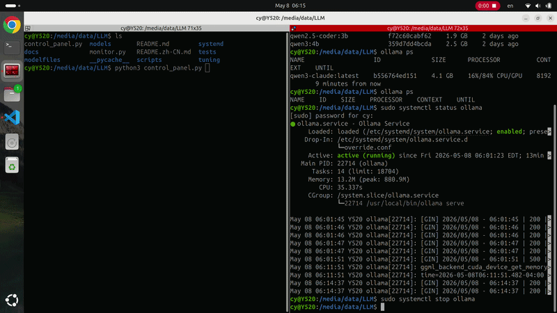

# Control Panel & Monitor

English | [简体中文](control-panel.zh-CN.md)

Two single-file Python dashboards — no dependencies beyond stdlib.

| | Control Panel | Monitor |
|---|---|---|
| Script | `control_panel.py` | `monitor.py` |
| Default port | 8766 | 8765 |
| Start / stop / restart services | yes | — |
| Load / unload / pull models | yes | — |
| Read-only status view | yes | yes |



## Running

```bash
python3 control_panel.py          # controls  →  http://localhost:8766
python3 monitor.py                # read-only →  http://localhost:8765
```

Monitor is useful on shared or remote machines where you want visibility without exposing service controls.

## What it shows

| Card | Contents |
|---|---|
| Services | Ollama/proxy systemd services plus llama.cpp, vLLM, and Strata endpoint health |
| GPU | VRAM usage, utilization, temperature |
| System | CPU model, cores, RAM meter |
| Storage | Root disk + Ollama models directory (highlights >85% full) |
| Models | Full Ollama model list with load / unload controls |

## Setup flow

The control panel detects when Ollama isn't running (shows a one-click start banner) and when no models are pulled (shows a pull catalog with one recommendation based on detected VRAM/RAM headroom). Once a model is pulled the panel transitions to the normal view automatically.

## Env vars

| Variable | Default | Effect |
|---|---|---|
| `LLM_DASHBOARD_PORT` | 8766 / 8765 | Override listen port |
| `LLM_DASHBOARD_HOST` | `127.0.0.1` | Override listen address |
| `LLM_MONITOR_CONTROLS` | `1` / `0` | Force controls on or off regardless of script |
| `LLM_PULLABLE_MODELS_JSON` | built-in starter catalog | JSON array of pullable Ollama model objects |
| `LLM_PULLABLE_MODELS_FILE` | — | Path to a JSON file containing the pull catalog |
| `LLAMA_CPP_BASE_URL` | `http://127.0.0.1:8080` | llama.cpp status/model discovery |
| `VLLM_BASE_URL` | `http://127.0.0.1:8000` | vLLM status/model discovery |
| `STRATA_BASE_URL` | `http://127.0.0.1:8082` | Strata status/model discovery |

```bash
LLM_DASHBOARD_PORT=9000 python3 control_panel.py
LLM_MONITOR_CONTROLS=1  python3 monitor.py      # monitor with controls enabled
```

Pull catalog entries use this shape:

```json
[
  {"name": "qwen2.5-coder:3b", "size_gb": 1.9, "desc": "coding"}
]
```

Controls only accept localhost connections and run as the current user.
